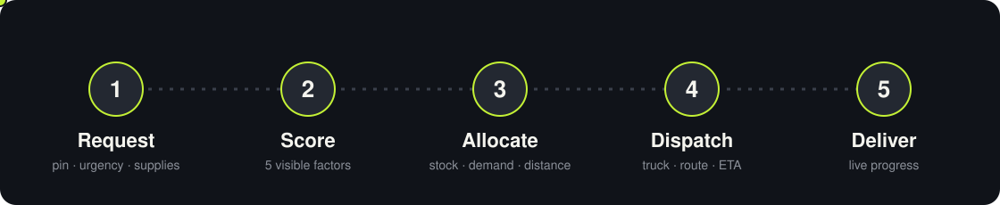
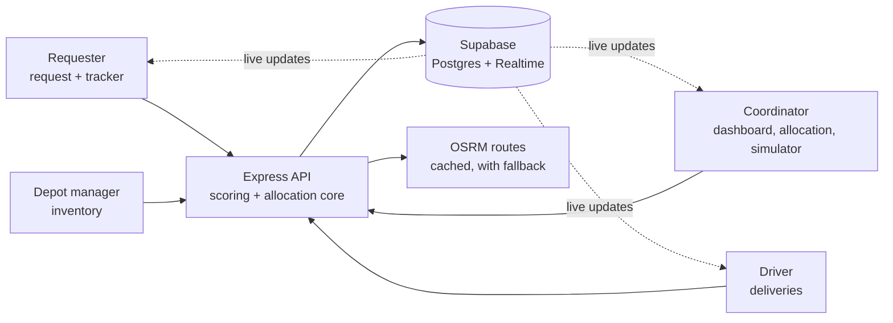
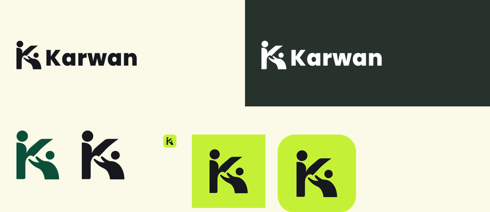

<div align="center">



<br><br>

<!-- REPLACE the two links below with your real URLs -->
<a href="https://karwan-front.vercel.app/"></a>
&nbsp;
<a href="https://YOUR-VIDEO-LINK"></a>

[PRD](docs/PRD.md)  |  [TRD](docs/TRD.md)  |  [User flow](docs/USER_FLOW.md)  |  [Design](docs/DESIGN.md)

<br><br>


</div>

<br>

**Karwan** (Urdu for *caravan*) is a coordination platform for flood relief. It puts help requests, depot stock and truck capacity in one place, ranks who needs help first with a score anyone can read, and recommends how to split limited supplies across affected areas. Then it tracks every delivery on a map until it lands.

Built for **CL-03: Disaster Relief Resource Optimizer**. All data in the demo is simulated: 12 flood-affected locations across Sindh, 3 depots, 6 trucks.

## Team

**Triple Bytes**

- Toufeeq Shaikh — [@toufeeqahmed916](https://github.com/toufeeqahmed916)
- Ayan Ali Shaikh — [@ayanalishaikh31-crypto](https://github.com/ayanalishaikh31-crypto)
- Ammar Talpur — [@ammartalpur](https://github.com/ammartalpur)

**Category:** Category 4 — Climate & Disaster Resilience


## The problem

In a flood, relief is not only short. It is often misplaced.

Requests arrive as calls, messages and field reports. Depot stock lives in notebooks. Trucks have limits on what they can carry and how far they can go. Nobody sees all three at once, so supplies tend to go to whoever called first or whoever is closest. The villages that are worst hit and hardest to reach wait the longest.

> **CL-03 brief:** *Build a coordination platform that matches requests for relief with available resources and recommends how limited supplies should be allocated across affected locations.*

## How Karwan solves it

| What goes wrong on the ground | What Karwan does |
|---|---|
| Needs are scattered across calls and messages | One request form. Drop a pin, set urgency, people affected, vulnerable group, access difficulty and the supplies needed. |
| Nobody knows what each depot actually has | Depot managers log stock, daily capacity and trucks. Low-stock alerts and a stock log keep it honest. |
| "Who goes first?" is a gut call | A five-factor priority score. Every point is visible and the weights can be changed with sliders. |
| Supply is short, so someone gets left out | Scarce stock is shared by priority and need, sent from the nearest depot, within depot capacity and truck availability. Every row explains itself in plain words. |
| Plans break when a road closes or stock drops | A what-if simulator. Change the situation, see who gains or loses, then apply it or undo it. |
| After dispatch, nobody knows where the truck is | Driver view, live truck on the map, and a requester tracker with ETA. |

## MVP checklist

Everything the brief asked for, and where to find it in the app.

| Expected MVP | Status | Where |
|---|:--:|---|
| Register requests with location, urgency and required supplies | ✅ | `/requester`. Map pin, urgency, people affected, 4 supply types. |
| Record available inventory and delivery capacity | ✅ | `/inventory`. Stock by item, low-stock thresholds, daily capacity, add or remove trucks. |
| Prioritise with transparent criteria | ✅ | `/requests`. Score breakdown per request, live re-ranking when weights change. |
| Recommend allocations from stock, demand and distance | ✅ | `/allocation`. Generate a plan, read the reason for each row, approve it. |
| Show allocation status and delivery progress | ✅ | `/dashboard` and `/tracker`. KPIs, status pipeline, coloured markers, routes, moving trucks. |
| Show how allocations change when supplies or needs change | ✅ | `/simulator`. Six what-if actions with a before/after comparison. |


## From request to doorstep



## How it decides

### 1. Priority score

Each request gets a score out of 100 made of five parts. The parts always add up to the total shown, so nobody has to trust a black box.


- **Urgency**: low, medium, high, critical
- **Affected people**: scaled against the largest request on the board
- **Vulnerable group**: children, elderly, patients (yes or no)
- **Waiting time**: grows over 48 hours, then caps
- **Hard to reach**: easy, medium, hard

Move a slider on the Requests page and the ranking re-sorts straight away.

### 2. Allocation

For each supply (water, food, medicine, shelter kits):

1. **Share the stock.** Total stock is split across requests in proportion to *priority score × amount needed*, never giving anyone more than they asked for. Leftovers are redistributed until stock runs out or everyone is covered.
2. **Pick the depot.** Each share is filled from the nearest depot that still has stock, daily capacity and a free truck. A blocked zone adds a 1.5× distance penalty.
3. **Explain it.** Every row carries a sentence such as which depot, how far, and why the request got less than it asked for (stock, capacity or trips needed).
4. **Compare.** The same demand is also run through a first-come-first-served baseline so coordinators can see both plans side by side.
5. **Approve.** Approval deducts stock, assigns trucks, writes dispatch logs and updates request status.

ETA is estimated from road distance at an average speed plus loading time. Road routes come from OSRM and are cached. If OSRM is slow or down, Karwan falls back to a straight-line estimate and draws it dashed so nobody mistakes it for a real route.

## Beyond the MVP

- **What-if simulator** with six actions: reduce stock, add stock, raise a community's population, add a new request, change depot capacity, block a road zone. Shows gained, lost and unchanged requests. Apply or undo.
- **Five map heat layers** on the dashboard: Need, Urgency, Supply gap, Delivery delay, Accessibility.
- **Driver app** with assigned load, route, *Start trip* and *Mark delivered*.
- **Requester tracker** with progress bar, ETA and live truck position, so the community sees what the coordinator sees.
- **Live updates** over Supabase Realtime, with automatic polling every 2 seconds if the connection drops.
- **Skip +6 hours** button to show how waiting time pushes requests up the ranking.
- **One-click demo reset** that restores seed data and stops running simulators.
- **Bilingual landing page** in English and Urdu with right-to-left layout.
- **Role-based screens** for coordinator, depot manager and driver.
- **32 backend test files** (Vitest and Supertest) plus API check scripts and a full end-to-end script.

## Who uses what

| Role | Screens | Job |
|---|---|---|
| Community member | `/requester`, `/tracker` | Ask for help, see when it arrives. No login. |
| Coordinator | `/dashboard`, `/requests`, `/allocation`, `/simulator` | Rank needs, approve plans, test scenarios. |
| Depot manager | `/inventory` | Keep stock, capacity and trucks accurate. |
| Driver | `/driver` | Start the trip, confirm the delivery. |

## Watch it work (3 to 4 minutes)

1. **Dashboard**: KPIs, marker colours, switch heat layers.
2. **Requester**: submit a request and see its priority score appear.
3. **Allocation**: generate the plan, read one reason, approve.
4. **Driver**: start the trip. The truck moves, the progress bar fills.
5. **Tracker**: the same delivery from the community side.
6. **Simulator**: cut water stock, recalculate, see who gains or loses.
7. **Dashboard**: back to the Supply gap layer.


## Project docs

Short and plain, written for people who just want to understand the project.

| Doc | What it covers |
|---|---|
| [PRD](docs/PRD.md) | The problem, users, MVP and extras |
| [TRD](docs/TRD.md) | Stack, score formula, allocation steps, API, tests |
| [User flow](docs/USER_FLOW.md) | Step-by-step flows with arrows for every role |
| [Design](docs/DESIGN.md) | Colours, type, components and screens |

## Architecture



```
frontend/   React 18, Vite, Tailwind, Leaflet, react-leaflet, leaflet.heat
backend/
  src/core/          score.js, allocation.js, truckProgress.js  (pure logic, easy to test)
  src/services/      scoring, allocation, scenarios, routes, deliveries, dashboard
  src/repositories/  all database access
  src/validators/    input checks for every endpoint
  tests/             Vitest + Supertest
```

The scoring and allocation logic is kept free of database code, so it can be tested and reasoned about on its own.

## Run it locally

You need **Node.js 22+** and a free [Supabase](https://supabase.com) project.

**1. Database.** Create a Supabase project and run the schema and seed SQL from `database/` (3 depots, 12 requests, 6 vehicles, 41 request items).

**2. Backend**

```bash
cd backend
cp .env.example .env     # add your Supabase URL and keys
npm install
npm run dev              # http://localhost:4000
```

**3. Frontend**

```bash
cd frontend
cp .env.example .env     # set VITE_API_URL and the Supabase public values
npm install
npm run dev              # http://localhost:5173
```

Demo logins for the staff roles are set in `frontend/.env` (see `.env.example`).

**No backend handy?** Set `VITE_USE_MOCKS=true` in `frontend/.env` to run the UI on bundled sample data.

**Checks**

```bash
cd backend
npm test
npm run check:e2e
npm run warm:routes      # optional: pre-fetch all depot to request routes
```

> Keep `SUPABASE_SECRET_KEY` in `backend/.env` only. It must never reach the frontend, a commit or a screenshot.

## Honest limits

- **Not an exact optimiser.** Allocation is a transparent heuristic (priority-weighted sharing, then nearest depot), not a linear-programming solver. We chose explainable over provably optimal, because a coordinator has to defend the plan.
- **Simulated data only.** No real requests, stock or road conditions.
- **Demo-grade login.** Staff roles use client-side demo credentials to separate screens. Real deployment would need proper authentication.
- **Straight-line fallback.** When road routing is unavailable, ETAs are estimates.

## What's next

- Multi-stop truck routes instead of one depot-to-request trip per row
- Real authentication and an audit trail for approvals
- SMS or WhatsApp request intake for areas with weak data coverage
- Offline-first driver screen

## Brand

<div align="center">

</div>

<br>

<div align="center">
<sub>Karwan · Built for CL-03 · Right help. Right place. Right now.</sub>
</div>
