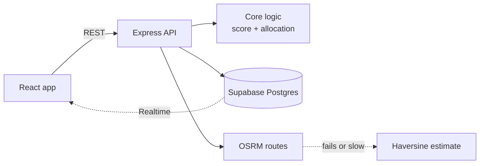

# Karwan: Technical Requirements (TRD)

## 1. Stack

| Layer | Tech |
|---|---|
| Frontend | React 18, Vite, Tailwind CSS, React Router |
| Maps | Leaflet, react-leaflet, leaflet.heat |
| Backend | Node.js 22, Express 5 |
| Database | Supabase (Postgres) |
| Live updates | Supabase Realtime, with 2-second polling as backup |
| Routing | OSRM road routes, cached, with straight-line fallback |
| Tests | Vitest, Supertest |

## 2. How the parts connect



## 3. Backend layers
Each layer has one job.

| Layer | Folder | Job |
|---|---|---|
| Routes | `src/routes` | Define endpoints |
| Validators | `src/validators` | Check input |
| Services | `src/services` | Business steps |
| Core | `src/core` | Pure logic: scoring, allocation, truck movement. No database code. |
| Repositories | `src/repositories` | All database reads and writes |

## 4. Data tables
`depots`, `inventory`, `vehicles`, `requests`, `request_items`, `allocations`, `stock_log`, `road_blocks`, `route_cache`, `scenarios`, `settings`

Views: `v_inventory` (low-stock flag), `v_request_fulfilment`

## 5. Priority score

```
score = urgency x w1 + people x w2 + vulnerable x w3 + waiting x w4 + access x w5   (each part 0 to 1, times 100)
```

| Factor | Default weight | How it is scaled |
|---|---|---|
| Urgency | 0.35 | low 0, medium 0.33, high 0.67, critical 1 |
| Affected people | 0.25 | people / largest request |
| Vulnerable group | 0.15 | yes 1, no 0 |
| Waiting time | 0.15 | hours / 48, max 1 |
| Hard to reach | 0.10 | easy 0, medium 0.5, hard 1 |

Parts are rounded so they always add up to the total shown.

## 6. Allocation steps
Done for each item (water, food, medicine, shelter):

1. Work out each request's remaining need.
2. Share available stock using **score x need** as the weight. Never give more than needed. Repeat with leftovers.
3. For each request, try depots from nearest to farthest. A depot must have stock, daily capacity left and a free truck.
4. Blocked zone: distance x 1.5.
5. ETA = distance / 45 km/h + 20 min loading.
6. Write a reason sentence for every row.
7. Run the same demand through a first-come-first-served plan as a baseline.

Approval: deduct stock, assign trucks, write the stock log, update request status.

## 7. API

| Area | Endpoints |
|---|---|
| Health | `GET /health/live`, `GET /health/ready` |
| Weights | `GET/PUT /api/settings/weights` |
| Requests | `GET/POST /api/requests`, `GET/PATCH /api/requests/:id` |
| Depots | `GET /api/depots`, `PATCH /api/depots/:id`, `PATCH /api/depots/:id/inventory` |
| Vehicles | `POST /api/depots/:id/vehicles`, `PATCH/DELETE /api/depots/:id/vehicles/:vehicleId` |
| Stock log | `GET /api/stock-log?depotId=` |
| Dashboard | `GET /api/dashboard` |
| Allocation | `POST /api/allocation/generate`, `POST /api/allocation/approve`, `GET /api/allocation` |
| Simulation | `POST /api/simulate/recalculate`, `/apply`, `/undo`, `/advance-time`; `GET /api/simulate/blocks`; `DELETE /api/simulate/blocks/:id` |
| Routes | `GET /api/routes?depotId=&requestId=` |
| Deliveries | `GET /api/deliveries`, `POST /api/deliveries/start`, `POST /api/deliveries/:allocationId/complete` |
| Reset | `POST /api/seed/reset` |

## 8. Delivery tracking
- When a trip starts, a simulator updates progress and truck position every second.
- On arrival the delivery completes, the request status updates and the truck is freed.
- The frontend listens through Realtime. If that fails, it polls every 2 seconds and shows a banner.

## 9. Non-functional rules
- Node 22 or newer.
- Secret key lives in `backend/.env` only.
- Errors use one standard format.
- CORS allows only the configured client origin.
- Route lookups time out after 5 seconds, then fall back.

## 10. Testing
- 32 backend test files (unit and route tests).
- Check scripts: `check:db`, `check:requests`, `check:inventory`, `check:allocation`, `check:dashboard`, `check:routes-deliveries`, `check:e2e`.

## 11. Known limits
- Allocation is a heuristic, not an exact solver.
- Staff login is demo-grade (client side).
- Fallback ETAs are straight-line estimates.
