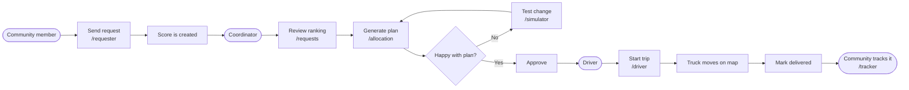
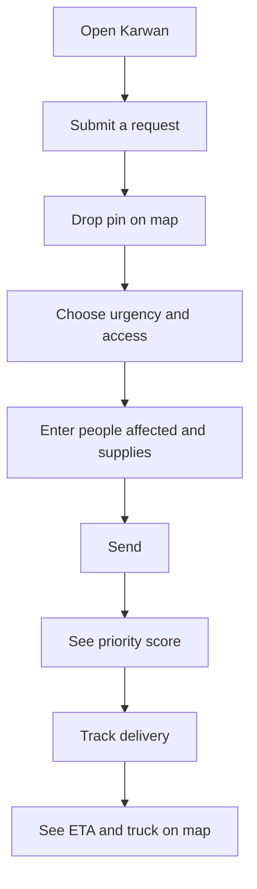
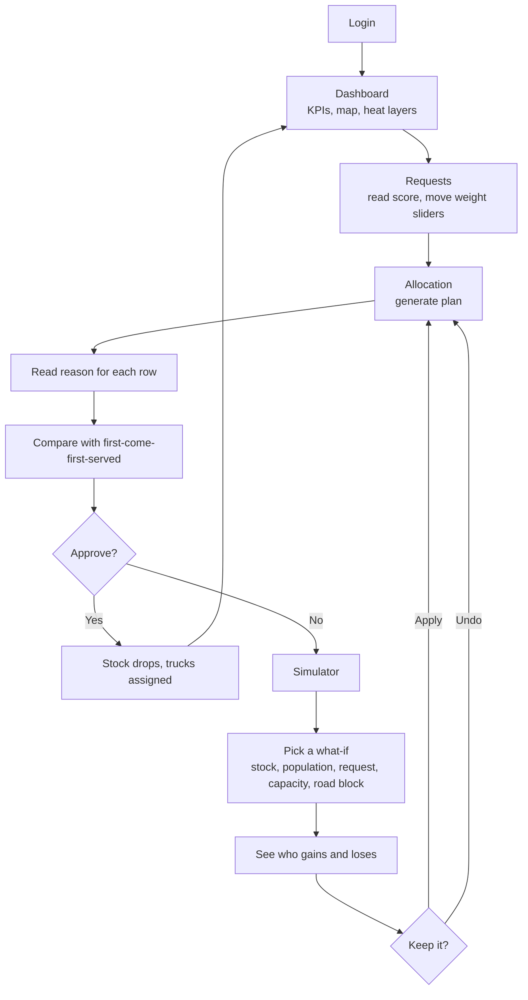
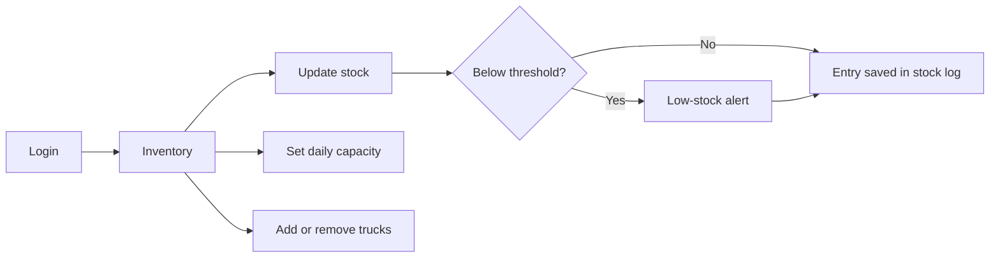
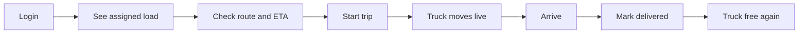
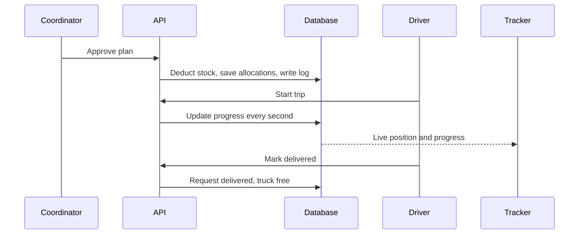

# Karwan: User Flows

Arrows show the order of steps. Rounded boxes are people, square boxes are screens, diamonds are decisions.

## 1. Big picture: from request to delivery

## 2. Community member

## 3. Coordinator

## 4. Depot manager

## 5. Driver

## 6. What happens in the system after approval

